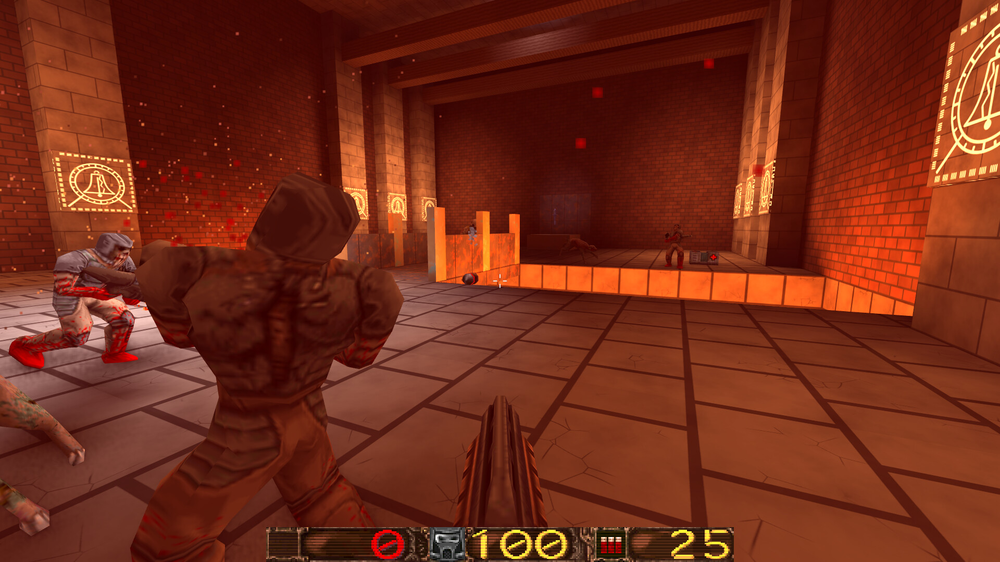

# Cinderkirk

A fast first person shooter in the old style, built for big screens and controllers. You're the last stoker at the bell foundry of Cinderkirk, built over a pit that never stopped burning, and something has come up out of it.

It's idea 25 in [game-ideas](https://github.com/LinuxGroove/game-ideas/blob/main/ideas/25-cinderkirk.md): Ken's modern Quake, made as an original game on the same tools (a vkQuake fork, QuakeC, ericw-tools) so it can ship freely. It's the first LinuxGroove game not made in Godot.



More in [docs/screenshots](docs/screenshots/): the splash, the main menu, the gatehouse, the Casting Floor from above, the pattern shop, the pouring gallery, the quench pit, a Deacon with two Ashen, the status bar, the weapon wheel, all eight weapons in hand (`weapons.jpg`), a pack of slag hounds (`slag-hounds.jpg`), and the pickups: ammunition, health, armour and a weapon on the floor (`pickups.jpg`).

## Where it's at

**Phase 1, the engine and tool chain, with a first playable level.**

- The engine is vkQuake 1.37.0, forked in `engine/` ([what changed](engine/CINDERKIRK.md)): its own game folder (`cinder/`), name and save folder, the LinuxGroove Games splash, and opening on the main menu. vkQuake already brings SDL 3 and Wayland, gyro aiming, flick stick, rumble, a render resolution separate from the menus and HUD, ambient occlusion, and external high-resolution textures with glow maps.
- **The Pithead** (`maps_src/start.py`), the hub every run starts in: the lift lever's four notches set the skill (Apprentice, Journeyman, Master, Founder's), a cage down each shaft opens off the hall (the Foundry's, the Cisterns', the Ossuary Kilns' and the Undervein's), the grate over the Throat lifts once all four shafts are beaten, and the trophy shelf on the west wall shows each shaft's Seal once it's taken (`misc_seal_trophy`).
- **The Foundry Gate** (`maps_src/foundry1.py`), the Foundry shaft's first map: the gatehouse, the Casting Floor with a slag channel and a bridge, the silver key, and the belfry behind the key door. Its world textures are the 1024 px Blender bakes from the mockup, so 8 texels a unit.
- **The rest of the Foundry shaft**: the Moulding Floor (`foundry2`: the core shop, the gold key and the drying ovens), the Furnace Row (`foundry3`: furnaces, the charging deck's lift, the silver key and the tapping yard), the Bell Pit (`foundry4`: terraces down to a bell's mould and back up to the gold door) and the Pour (`foundry5`: free the crane's two chains and the cope lifts off the Foundry Seal), with a secret map, the Ash Pit (`foundry_s`), through a cracked wall in the Furnace Row's coal store.
- **The Cisterns shaft**: the Quench House (`cisterns1`: the tiled quench house, its sunken tank and the silver sluice), the Long Vault (`cisterns2`: the channel under the vault, the pump rooms and the gold key on the channel's bed), the Settling Tanks (`cisterns3`: six tanks, the catwalks and the lift), the Flowstone Stair (`cisterns4`: four flights down a limed well to a pool) and the Great Cistern (`cisterns5`: open both sluices and the cope lifts off the Cistern Seal), with a secret map, the Drowned Chapel (`cisterns_s`, where the Quench Suit lies), through a cracked wall in the Long Vault's south pump room. Its textures are 256 px previews until they're baked. Leeches live in its water: they fasten on and drag you down until you dash, which works under water while one is on you.
- **The Ossuary Kilns shaft**: the Charnel Stair (`kilns1`: the old crypt, a stair between walls of stacked bones and the charnel hall, where the ash wraiths start), the Bone Kilns (`kilns2`: kilns down both sides with slag in their hearths, the gold key on a pedestal over one), the Ash Galleries (`kilns3`: three galleries round a hall full of wraiths, the key at the top and the door at the bottom), the Sorting House (`kilns4`: the first bell-ringer, stages to stand on clear of its toll, and four chains that lift the key's cage) and the Calcining Floor (`kilns5`: two bell-ringers, slag trenches, and two dampers that lift the cope off the Kiln Seal), with a secret map, the Reliquary (`kilns_s`, where the Soot Veil lies), through a cracked wall on the Ash Galleries' middle gallery. 
- **The Undervein shaft**: the Adit (`vein1`: a timbered drift with the ore rails and the ore hall's tipple, where the silver key is), the Stopes (`vein2`: a staged stope with the gold key on top, and a deeper one where the rock glows and slag pools), the Winding Engine (`vein3`: the engine house and the cage down the main shaft, which drops when you step in, and the old workings at the bottom), the Hot Workings (`vein4`: a slag river crossed on its stones, the gold key on the high working) and the Founder's Mould (`vein5`: the Founder's fight on the casting floor, and the Vein Seal under a cope that lifts when he dies), with a secret map, the Lode (`vein_s`, where the Founder's Mantle lies), through a cracked wall in the Winding Engine's old workings. The Founder and the Undervein's textures are 256 px previews until they're baked.
- **The Throat**, the finale, under the Pithead's grate: the Throat (`throat1`: a stair round the walls of a square well two thousand units deep, ash wraiths in the air, the silver key in the old sounding chamber) and the Casting Floor (`throat2`: the Throat itself rising out of the slag, which nothing you carry can hurt, under the cracked Great Bell on its four chains; knock the four brakes off and each drops the bell and lets out what waits behind it, until it falls and corks the Throat, and the night ends). The bell and the Throat are 256 px previews until they're baked.
- **Pit fights** for 2 to 8 on LAN or online, with bots: Multiplayer, New Game, Pit fight, and set how many bots join (`bots`). Four arenas: the Cooling Yard (`pit1`: a casting yard with a gantry and the Forge Heart), the Belfry (`pit2`: two galleries round an empty bell tower, the Founder's Mantle on top), the Slag Run (`pit3`: a hall split by slag and crossed by three bridges, the Soot Veil on the middle one) and the Charnel Kiln (`pit4`: nine kiln bays with a gallery and the Quench Suit over the firebox). The bots (`quakec/cinder/bots.qc`) are real players to the engine, so they score and respawn; they need no waypoints, keep out of the slag, and aim by the skill.
- **Co-op Story** for 2 to 4 on LAN or online (Multiplayer, New Game, Co-op Story): more creatures on each skill (a second one beside every third creature on Apprentice, every second on Journeyman, and every one on Master and Founder's, `quakec/cinder/coop.qc`), and players come in beside the start rather than on top of each other.
- **Records**: the end of every Story map says whether you beat your best time there at that skill, or what the best is, and each map's fastest time, most kills and most secrets per skill are kept in `records.txt` in the user folder (`engine/Quake/records.c`). Find every secret in all five maps down a shaft and its cage in the Pithead gets a glowing mark over the door.
- **Bloom**: slag, glyph stones and lamps glow past their edges (`r_bloom`, 0 turns it off).
- The menus, cursor, side plaque and console background are Cinderkirk's own, drawn at 4× so they stay sharp at 4K.
- **Rumble** is designed, not loudness: each weapon's shot, a hit taken, the dash, Overpressure, a vent, a pickup and a secret have their own short pattern (`engine/Quake/rumble.c`), sent by the game code to the one player it happens to (`quakec/cinder/rumble.qc`).
- **The status bar and the weapon wheel** are vector art: `tools/hud_svg.py` writes them as SVG (text turned to paths from the game's fonts) and the engine rasterises them with nanosvg at the screen's own resolution, so they're as sharp at 4K as at 720p. The Pressure dial sits in the middle of the bar, with the eight weapons in a row above it. Hold LB (or Q) for the wheel: the right stick, the gyro or the mouse points, letting go equips, a tap goes back to the last weapon, and time slows to a third while it's open in single player.
- **Button glyphs** follow the device used last: the keyboard and mouse, or an Xbox, PlayStation, Switch or Steam Deck pad (Kenney's Input Prompts, `tools/glyphs.py`). Messages name a command in braces, `{+jump}`, and show the button bound to it; the gatehouse teaches the dash, the wheel and Overpressure that way (`docs/screenshots/glyphs.jpg`).
- **Normal and gloss maps** on the world: ericw-tools' light also writes the direction light comes from at each lightmap sample, so stone and brick show their relief against the level's real lights and gloss catches them as you move (`docs/screenshots/normal-maps.jpg`).
- The Ashen, Censer-bearers, Deacons, slag hounds, Gaugers (steam lances that hiss before they fire), Crucible Brutes (they pour slag along the floor) and clinkers (they hang from ceilings, drop and burst), cistern leeches, ash wraiths (they drift as a cloud nothing can hit and are solid only while they swoop), bell-ringers (their toll runs along the floor: jump it), the Founder (he pours iron along the floor, flings it, slams the floor so it rings out round him, and past half his health the roof drips iron on you), the weapons, the stoker as other players see him (with each player's colours on his jacket and coat), the gibs, the projectiles, the explosion and bubble sprites (`tools/sprites.py`), the pickups (health, ammunition, armour, keys, the backpack) and the powerups (the Forge Heart, the Founder's Mantle, the Soot Veil and the Quench Suit) are Cinderkirk's own; so are every sound in Story and Pit fights (the stoker, doors, lifts, levers, pickups, weapons, water and the ambient beds, all synthesized by `tools/sfx.py` and `tools/sfx_world.py`); the monsters the maps don't use and their sounds are still **stand-ins from LibreQuake** (BSD-3) until Cinderkirk's own are made, and the game code is LibreQuake's QuakeC (GPL-2.0). The menus already use Cinderkirk's words: Story, Pit Fights, Apprentice to Bellfounder.
- **Making levels in TrenchBroom**: `make trenchbroom` writes a game config and every entity (from the game code's QUAKED comments, with the creatures' and pickups' models) for TrenchBroom, and a level saved as `maps_src/<map>.map` builds with the rest; see [docs/mapping.md](docs/mapping.md).
- **Music**: each map's `sounds` picks a track (`music/trackNN.ogg`): one for the Pithead, each shaft, the Throat, the end of a map, the big fights and Pit fights. Dark ambient and industrial, made with ACE-Step by `tools/lemonade/generate.py` from the prompts in `tools/lemonade/audio.json` (`assets_src/music/GENERATED.md` has each track's seed).
- Snap packaging for amd64 and arm64 (core24, strict), so it installs on Ubuntu and Ubuntu Core, and a tarball to unpack and play on any Linux from 2024 on (`make tarball`; the **Tarball** workflow attaches one per architecture to each GitHub release).

Next: the renderer (HDR lightmaps, bloom and tone mapping, normal and gloss maps on models), then polish for release.

## Playing it

```sh
sudo snap install cinderkirk_*.snap --dangerous   # a snap from CI's artifacts
cinderkirk
```

Or unpack a tarball from a release and run `./cinderkirk` in its folder (`./install-desktop-entry` adds it to the applications menu).

From source on Ubuntu 24.04 (the packages are listed in `.github/workflows/ci.yml`):

```sh
make            # first time: builds SDL 3, the Vulkan loader, spirv-opt, ericw-tools and fteqcc (a few minutes)
make run        # dist/cinderkirk -basedir dist
make run ARGS="+map start"
```

Controls: a controller just works (left stick moves, right stick or gyro looks, right trigger fires, A jumps, hold LB for the weapon wheel or tap it for the last weapon, RB changes weapon, the d-pad picks one). Keyboard and mouse are the usual WASD. Comfort settings are on by default: no view bob, roll or gun kick (`cinder/default.cfg`).

## Layout

| Path | What |
|---|---|
| `engine/` | The vkQuake fork (C, Vulkan, Meson) |
| `quakec/` | The game code, built with fteqcc into `build/progs.dat` |
| `maps_src/` | Levels in code: each `<map>.py` writes a `.map` (TrenchBroom opens it) with `tools/mapkit.py` |
| `assets_src/materials/` | Blender scripts that bake the world textures (`make textures`) |
| `assets_src/models/` | `creatures.py` builds, rigs, animates and skins the creatures in Blender and writes them as MD3 (`make models`; `PREVIEW=dir` adds a sheet of their frames); `weapons.py` builds the weapons the player holds, with the stoker's glove, the same way (`make -j8 weapons`, one Blender run each, side by side; `VIEWSHOT=dir` shows them from the eye, `WORLD=1` builds them as they lie on the floor); `pickups.py` builds health, ammunition, armour, keys and the backpack (`make -j8 pickups`, which also runs `weapons.py` with `WORLD=1`); `actors.py` builds the stoker as other players see him (`player.md3` with a `_colors.png` mask for player colours, in player.qc's frame order), his head, the gibs and the projectiles under the stand-ins' names, so the engine loads them in place of the .mdl files (`make -j8 actors`); `models.py` is the idea's mockup |
| `assets/models/` | The creatures and the view models (`v_*`) as the game loads them: `<name>.md3`, its skin and `_luma` glow, and `.frames` (the frame order their QuakeC lists) |
| `assets_src/fonts/` | Cinzel and Barlow Condensed, for the menus and the HUD |
| `assets/textures/` | The baked textures: `<name>.png`, `_luma`, and `_norm` and `_gloss`, which the renderer shades with the light's direction from each map's `.lux` (`r_normalmaps`, `r_glossmaps`) |
| `cinder/` | Loose game files: `default.cfg` (controls and comfort defaults) and `quake.rc` |
| `gfx/splash.png` | The LinuxGroove Games splash |
| `tools/` | The build's helpers: `wad.py` (texture WADs), `pak.py`, `menu_art.py`, `hud_svg.py` (the status bar and weapon wheel as SVG), `sfx.py` and `sfx_world.py` (every sound the game plays, synthesized), `make_icon.py`, `mapkit.py`, `deps.sh`, `tools.sh`, `librequake.sh`, `versions.sh` (every pinned version), `shoot.sh` (screenshots on a machine with no screen), `version.sh` |
| `snap/` | The snap: `snapcraft.yaml`, the launcher and the desktop file |
| `build/`, `dist/` | Made by `make`; `dist/` is the game, ready to run |

## How it's built

1. `tools/deps.sh` builds SDL 3, the Vulkan headers and loader (vkQuake needs 1.4.341) and `spirv-opt` into `build/prefix`; `tools/tools.sh` builds qbsp, vis, light and fteqcc into `build/bin`; `tools/librequake.sh` fetches LibreQuake's stand-ins at a pinned commit and compiles its little box models (the exploding barrels still use them).
2. The engine builds with Meson against `build/prefix`.
3. The QuakeC compiles to `build/progs.dat`.
4. `tools/wad.py` turns the baked textures into a small WAD for qbsp (128 px stand-ins, so a texture repeats every 128 units); the engine draws the full 1024 px PNGs from `textures/` in their place, with their `_luma` glow.
5. Each level script writes its `.map`, then qbsp, vis and light (`-extra4 -bounce -lit`) compile it.
6. `tools/menu_art.py` draws the menus, `tools/hud_svg.py` writes the HUD's SVG into `gfx/hud/`, and `tools/sfx.py` synthesizes the sounds; everything, with the creatures from `assets/models/` in `progs/`, goes into `dist/cinder/pak0.pak`.

Screenshots on a machine with no GPU: `VK_ICD_FILENAMES=/usr/share/vulkan/icd.d/lvp_icd.json tools/shoot.sh /tmp/shot "20" +map start`, with `SPAWN="notarget; god; setpos X Y Z PITCH YAW 0"` to place the view.

## Licences

The engine and game code are GPL-2.0-or-later (`LICENSE`); see `CREDITS.md` for everything else. Nothing of id Software's Quake data is used.
